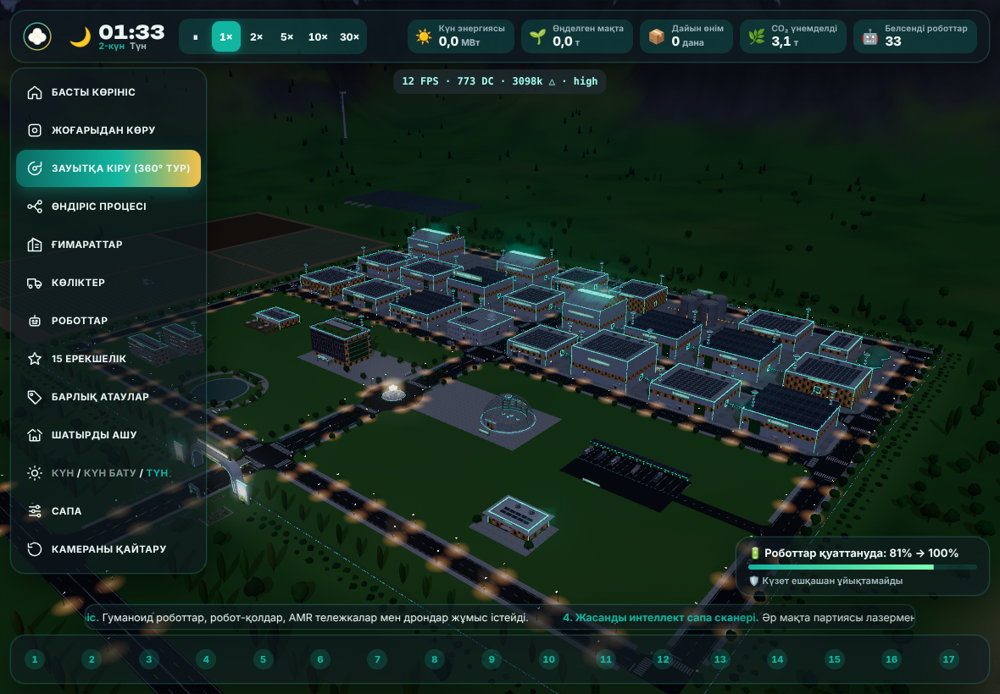
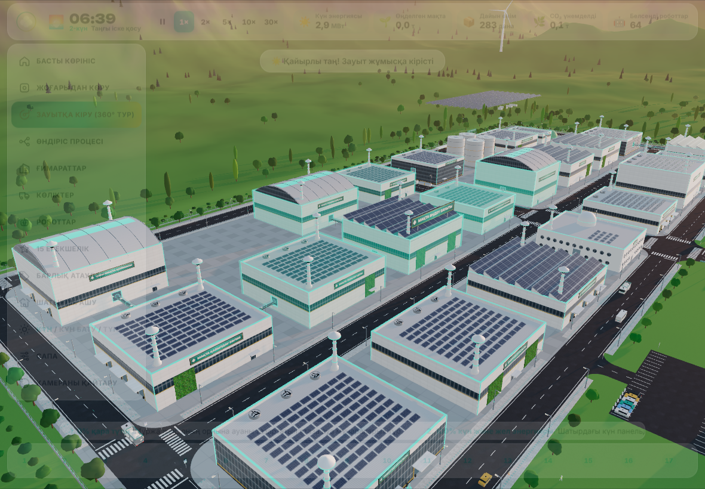
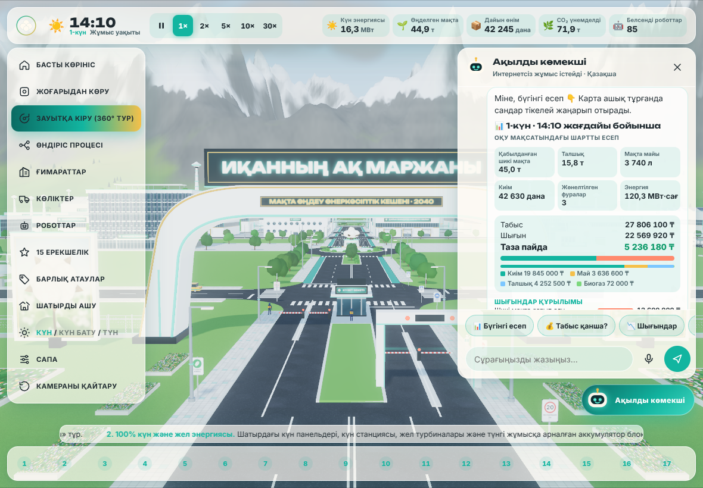
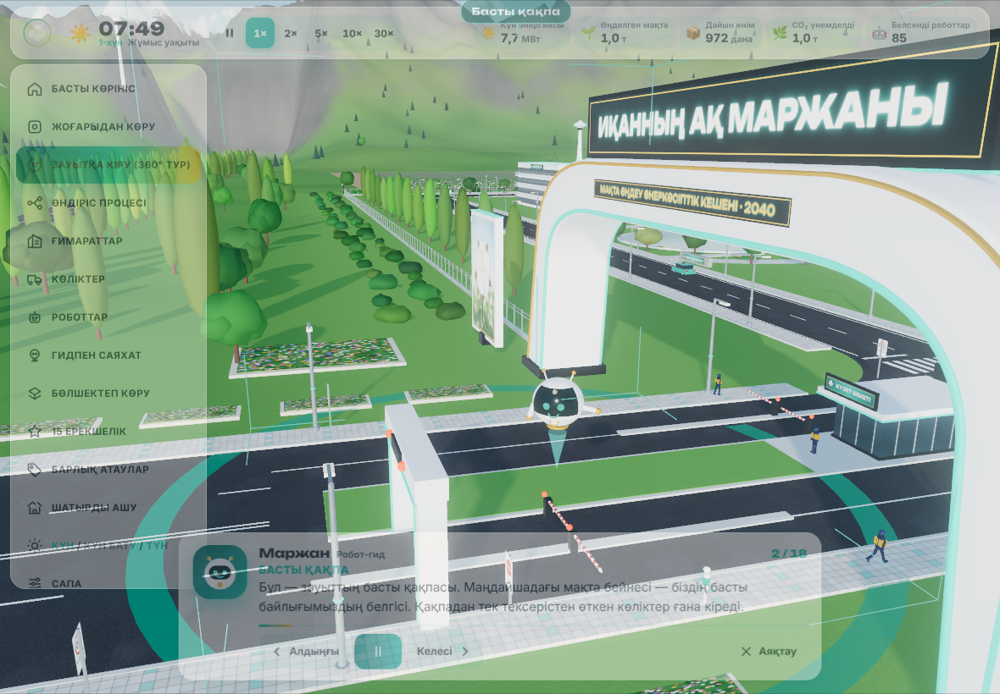
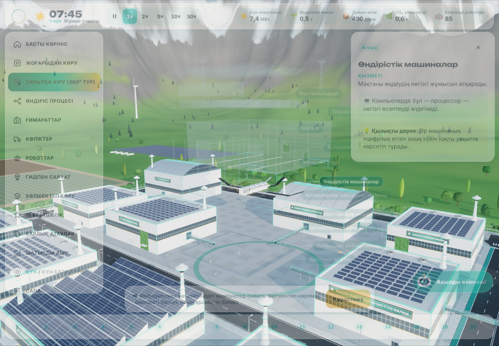
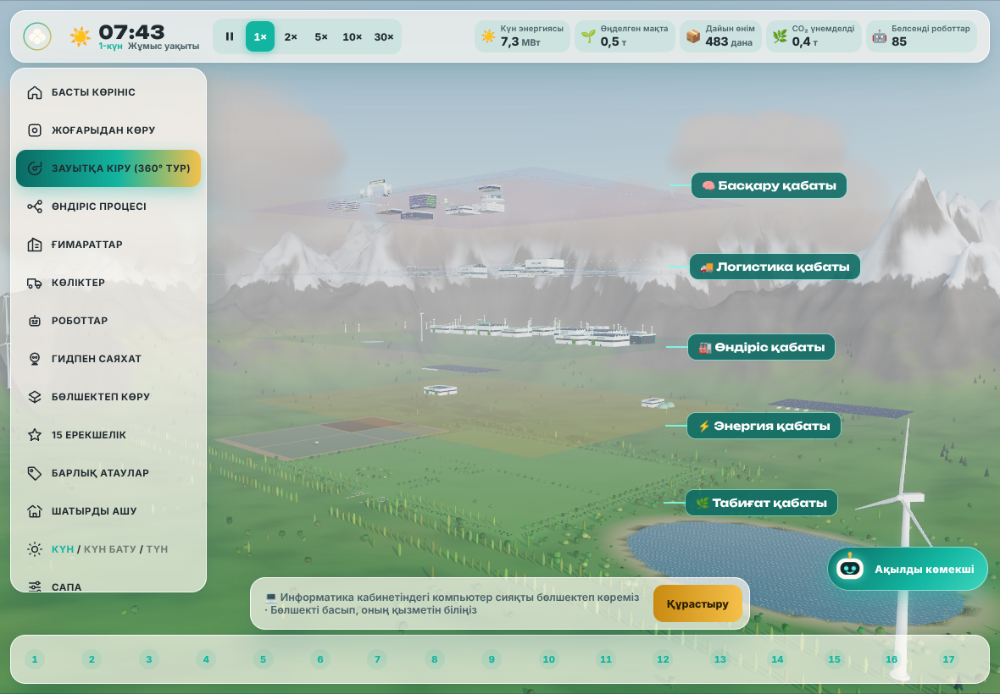
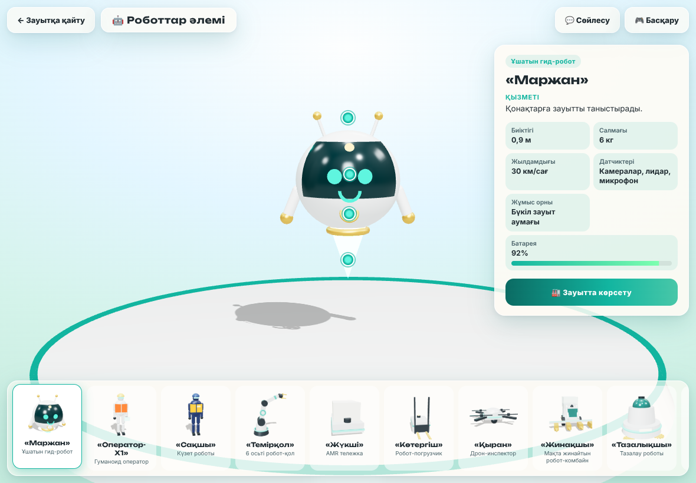
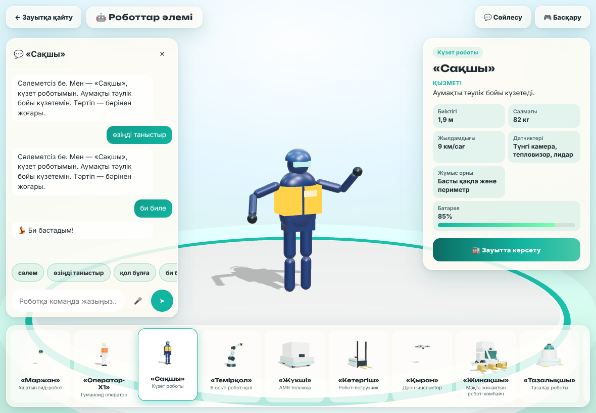

# «Иқанның Ақ Маржаны» — болашақтың мақта зауыты

2040 жылғы **түтінсіз мақта өңдеу өнеркәсіптік кешенінің** интерактивті 3D прототипі. Жоба мектеп олимпиадасындағы таныстыруға арналған. Ол iPad-та (Safari), компьютерде және телефонда браузер арқылы ашылады.

### 🌐 Сайтқа сілтеме: **https://nurdavlatmirzahmetov003-cpu.github.io/makta-zauyt-3d/**


## Идея
- **Түтінсіз зауыт.** Мұржа да, қара түтін де жоқ. Олардың орнында көгілдір сақиналары жарқыраған ақ «Таза ауа мұнаралары» тұр.
- **100% жаңартылатын энергия.** Шатырдағы күн панельдері, күн станциясы, жел турбиналары және аккумулятор блоктары бар.
- **Табиғат аясында.** Зауыттың айналасында қарлы таулар, көл, орман белдеулері мен мақта алқаптары орналасқан.
- **Толық роботтандырылған өндіріс.** Мақта алқаптан келіп, 17 кезеңнен өтеді, сосын буып-түйіліп, экспортқа жөнелтіледі. Мақта цехтан цехқа шыны құбырлар арқылы өтеді, сондықтан бүкіл тізбек көзге көрініп тұрады.
- **Ақылды көліктер мен роботтар.** Жүргізушісіз электр фуралар, гуманоид роботтар, робот-қолдар, AMR тележкалар мен дрондар жұмыс істейді.
- Түнде кешен LED жарықтарымен нұрланып тұрады.

## Скриншоттар
| | |
|---|---|
|  |  |
| Басты қақпа мен ескерткіш | Цехтың шатыры ашылып, ақпарат картасы көрсетіледі |
|  |  |
| 360° тур: 1-кезең | Мақта шыны құбырмен келесі цехқа өтіп барады |
|  |  |
| Финал: «ЭКСПОРТ ✈️ Әлемнің 30 еліне» | Түнгі нұрлы сәулет |
|  |  |
| Көрме залындағы «15 ЕРЕКШЕЛІК» LED экраны | Күн бату |

## 🎤 Қорғауға арналған 2 минуттық сценарий
| Уақыт | Не көрсету керек | Не айту керек |
|---|---|---|
| **0:00–0:15** | Кіру беті → **«ЗАУЫТҚА КІРУ»** батырмасы. Камера таулардың үстімен ұшып келеді. | «Бұл — 2040 жылғы Иқан ауылындағы түтінсіз мақта зауыты. Бірде-бір мұржа жоқ.» |
| **0:15–0:30** | Қақпа көрінісі. Жоғарғы панельдегі сандарды көрсету: күн энергиясы, өңделген мақта, дайын өнім, CO₂, роботтар. | «Зауыт 100% күн мен желдің энергиясымен жұмыс істейді. Сандардың бәрі нақты уақытта жаңарып тұрады.» |
| **0:30–1:15** | Сол жақ мәзір → **«ЗАУЫТҚА КІРУ (360° ТУР)»**. Камера қабылдау бөліміне ұшады, шатыр ашылады. Мақта шыны құбырмен келесі цехқа өтеді. | «Мақта таразыда өлшеніп, жасанды интеллект сканерімен тексеріледі. Кейін ол тазаланып, джин-машинада талшық пен тұқымға бөлінеді. Оң жақ панельде әр кезеңде не болып жатқаны және роботтардың не істейтіні жазылған.» |
| **1:15–1:35** | **«Келесі ▶»** батырмасымен 2–3 кезеңге өтіп, сосын төменгі жолақтағы **17** нөмірін басу. Тағы **«Келесі ▶»** басылса, фура қақпадан шығады. | «Мақта алқаптан шығып, 17 кезеңнен өтеді. Соңында жүргізушісіз электр фура өнімді әлемнің 30 еліне апарады.» |
| **1:35–1:50** | Мәзір → **«КҮН / КҮН БАТУ / ТҮН»** батырмасын екі рет басу. | «Түнде үнемді LED жарықтары ғимараттарды көркейтеді, ал жұлдыздар мен ай жарығы шығады.» |
| **1:50–2:00** | Мәзір → **«15 ЕРЕКШЕЛІК»** → «Көрме залындағы LED экранды көру». | «Біздің жобамыздың 15 ерекшелігі көрме залындағы үлкен экранда көрсетілген. Назарларыңызға рахмет!» |

**Кеңес:**
- Турды кез келген сәтте экранды ұстап тоқтатуға болады. Камера сол станцияның айналасында қолмен айналады, ал **▶** батырмасы турды жалғастырады.
- iPad-та сапа автоматты түрде «Орташа» болады. Кадр жиілігі төмендесе, сапа өздігінен азаяды.

## Басқару
- **Бір саусақ** — айналдыру, **екі саусақ** — жақындату және жылжыту.
- **Нысанды басу** — ғимаратты, көлікті немесе роботты таңдап, ол туралы ақпарат картасын ашу.
- **Ілесу** — таңдалған көлікке немесе роботқа камерамен ілесу.
- **Тізімдер** — ғимараттарды, көліктерді, роботтарды және 17 кезеңді іздеу.
- **Шатырды ашу** — цехтың ішін көру.
- **Барлық атаулар** — ғимараттар мен көліктердің атауларын қосу.
- **Сапа** — Төмен / Орташа / Жоғары. «Жоғары» сапада жарқырау (bloom) әсері қосылады.
- Пернетақтамен де басқаруға болады:
  - **Бос орын** — турды тоқтату немесе жалғастыру;
  - **← / →** — алдыңғы немесе келесі кезең;
  - **Esc** — терезелерді жабу.

## Іске қосу
```bash
npm i
npm run dev      # әзірлеу сервері (iPad-тан ашу үшін бір Wi-Fi желісінде болу керек)
npm run build    # статикалық сайт docs/ қалтасына жиналады
npm run preview  # жиналған сайтты тексеру
npm run qa       # барлық батырманы басып тексеретін автоматты тест (Playwright)
```
Қосымша: `?debug` параметрі FPS пен draw call санын көрсетеді, сондай-ақ қазақ әріптерінің қаріптерде дұрыс шығуын тексереді.

## Технология
- **Three.js 0.170** + **Vite**, таза JavaScript. Сыртқы 3D модель де, сурет те жоқ: таулар, ғимараттар, машиналар, роботтар мен текстуралардың бәрі кодпен жасалған.
- Геометрия материал бойынша біріктіріліп, қайталанатын нысандар instancing арқылы салынады. Сондықтан ең ауыр көріністің өзінде кадрға 1 300-ден аз draw call кетеді (шек — 1 500).
- Барлық мәтін қазақша жазылған, қаріптер жоба ішінде сақталған. Сайт интернетсіз де жұмыс істейді.

## GitHub Pages-ті қосу
1. Репозиторийде **Settings → Pages** бөліміне өтіңіз.
2. **Source** өрісінде **GitHub Actions** таңдаңыз.
3. `main` тармағына әр push жасалған сайын сайт автоматты түрде жиналып, жарияланады.

Қосалқы нұсқа: **Source → Deploy from a branch → `main` / `/docs`** таңдауға болады, өйткені жиналған `docs/` қалтасы да репозиторийде сақталады.

## Қаріптер туралы
Интерфейс **Inter**, ал тақырыптар **Unbounded** қарпімен жазылған. Түпнұсқа Unbounded қарпінде Ә Ғ Қ Ң Ө Ұ Ү Һ әріптері жоқ. Сондықтан `scripts/build-kz-font.py` скрипті бұл әріптерді Unbounded стилінде құрастырып, `src/fonts/` қалтасына қосымша қаріп ретінде сақтайды (OFL-1.1 лицензиясы рұқсат етеді).

---

# 2-бөлім: тірі зауыт, ақылды көмекші, робот-гид және роботтар әлемі

### 🤖 Роботтар әлемі: **https://nurdavlatmirzahmetov003-cpu.github.io/makta-zauyt-3d/robots.html**

## Не қосылды
- **Тірі зауыт.**
  - Сайт ашылғанда сағат 07:40, «1-күн», зауыт сол сәттен бастап жұмыс істеп тұрады.
  - Уақыт жылдамдығы: ⏸ 1× 2× 5× 10× 30×.
  - 06:30-да зауыт жарық толқынымен оянады, 12:00-де түскі үзіліс басталады. 20:00-де мақта қабылдау тоқтайды, 21:00-де зауыт «ұйқыға кетеді».
  - Түнде ай, Құс жолы және жарқырауық қоңыздар көрінеді. Күзет роботтары мен дрондар ешқашан ұйықтамайды.
- **Экономика.**
  - Табыс, шығын, таза пайда, энергия және CO₂ нақты өнім ағынының оқиғаларынан есептеледі. Бұл — «Оқу мақсатындағы шартты есеп».
  - Электрге 0 ₸ жұмсалады, себебі қуат күн мен желден алынады.
- **«Ақылды көмекші».**
  - Интернетсіз жұмыс істейтін қазақша чат-бот.
  - Күнделікті есепті графиктермен көрсетеді, есепті CSV етіп жүктеуге немесе басып шығаруға болады.
  - Уақытты басқарады және кез келген ғимаратқа апарады.
- **«Маржан» робот-гиді.** Шатырлардың үстімен ұшып, 18 нысанды өз сөзімен түсіндіреді.
- **«Бөлшектеп көру».**
  - Цех 11 бөлшекке ажырайды, әр бөлшектің «💻 Компьютерде бұл — …» деген салыстыруы бар.
  - Бүкіл база 5 қабатқа бөлінеді: табиғат, энергия, өндіріс, логистика, басқару.
- **«Роботтар әлемі».**
  - 12 робот 360° айналатын студияда тұрады, әрқайсысында белсенді нүктелер бар.
  - Әр роботтың өз мінезі бар. Оны сөйлесуге болады және оған команда беруге болады: би, секіру, айналу, жұмыс т.б.
  - Роботты джойстикпен басқаруға болады. «Зауытта көрсету» батырмасы сол роботты зауыттан көрсетеді.
- **«Роботты басқару».** Зауытта гуманоид роботты немесе дронды джойстикпен басқаруға болады. Олар ғимараттар мен көліктерге соқтығыспайды.

| | |
|---|---|
|  |  |
| Түн: зауыт ұйықтап жатыр, роботтар қуат алуда | 06:39: зауыт жарық толқынымен оянады |
|  |  |
| «Ақылды көмекші»: күнделікті есеп | «Маржан» робот-гиді басты қақпада |
|  |  |
| Цех бөлшектерге ажырады | Бүкіл база 5 қабатқа бөлінді |
|  |  |
| «Роботтар әлемі»: Маржан | «Сақшы» өзін таныстырып, билейді |

## 🎤 Қазылар алқасына 3 минуттық көрсету сценарийі
| Уақыт | Не көрсету керек | Не айту керек |
|---|---|---|
| **0:00–0:20** | Сайтқа кіру. Жоғарғы панельдегі сағатты (07:40, «1-күн») көрсетіп, **30×** батырмасын басу. | «Біздің зауыт тірі: ешкім іске қоспай-ақ өзі жұмыс істейді. Бір секунд — бір ойын минуты.» |
| **0:20–0:45** | Сағатты немесе есептегіштерді басу. «📊 1-күн · … жағдайы бойынша» панелі ашылады. | «Табыс пен шығын ойдан шығарылған жоқ, нақты өндірістен есептеледі. Электрге 0 ₸ кетеді, себебі қуат күн мен желден алынады.» |
| **0:45–1:10** | «Ақылды көмекші» → «📊 Бүгінгі есеп» чипі, сосын «⬇️ CSV жүктеу». Чатқа «зертхананы көрсет» деп жазу. | «Чат-бот интернетсіз, қазақша жұмыс істейді. Есепті Excel-ге жүктеуге болады.» |
| **1:10–1:40** | Мәзір → **«ГИДПЕН САЯХАТ»**. Маржан 2–3 нысанды көрсеткенше күту, сосын «✕ Аяқтау». | «Бұл — Маржан, біздің ұшатын робот-гид. Ол әр нысанды өзі түсіндіреді.» |
| **1:40–2:10** | Тоқу немесе тігу цехын басып, **«🧩 Бөлшектеу»** батырмасын басу. «Өндірістік машиналар» бөлшегін таңдау. Сосын «Құрастыру» → «Бүкіл базаны бөлшектеу». | «Информатика кабинетінде компьютерді бөлшектегендей, зауытты да бөлшектеп көрсетеміз. Машиналар — процессор, конвейер — деректер шинасы.» |
| **2:10–2:30** | **«КҮН / КҮН БАТУ / ТҮН»** батырмасын екі рет басу (немесе чатқа «түнге ауыстыр» деп жазу). | «21:00-де зауыт ұйқыға кетеді. Роботтар қуат алады, ал күзет ешқашан ұйықтамайды.» |
| **2:30–3:00** | **«РОБОТТАР ӘЛЕМІ»** → «Сақшыны» таңдау → «💬 Сөйлесу» → «би биле», «жарықты сөндір» командалары. Сосын «🎮 Басқару» → джойстикті қозғалту. | «Әр роботпен сөйлесуге, оған команда беруге және оны басқаруға болады. Назарларыңызға рахмет!» |
